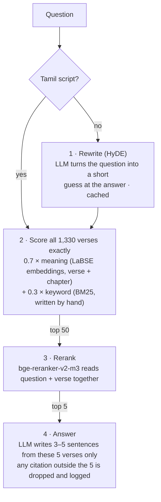

# Kural RAG

**Ask a life question in English, Tamil or Thanglish. Get the Thirukkural verses that answer it, with a short answer that cites them.**


**Live site:** [kural-rag.vercel.app](https://kural-rag.vercel.app)

> *"How do I control my anger?"* → verses from chapter 31 (*Restraining Anger*) and verse 35, each shown with the
> Tamil original, English translations, modern Tamil readings and classical commentary, plus a 3–5 sentence answer
> that cites them by number.

The Thirukkural is a classical Tamil text of **1,330 two-line verses** in 133 chapters, on ethics, governance and
love. This project is a retrieval-augmented generation (RAG) system built by hand: every stage was measured on a
fixed question set, and a change shipped only when it was a statistically real improvement.

| Right verse in top 5 | Right verse ranked first | Golden set (100 questions) |
|:---:|:---:|:---:|
| **78%** (182 / 233) | **56%** (131 / 233) | **44 → 97** right in top 5 |

---

## Why it is hard

- **Different languages.** The question is modern English; the verse is classical Tamil.
- **Different words.** A reader types *"lazy"*; the 1880s English translation says *"sloth"*.
- **No invented meanings.** The answer may only use the verses it was given, and every citation is checked in code.

## How it works



- **Exact search only.** Every query is compared against all 1,330 verses; there is no approximate index. A speed-up
  is allowed only if it changes zero answers on the test set.
- **Two services.** The models take seconds and gigabytes to load, so a long-running **FastAPI** service loads them
  once and serves `/search` and `/generate`. The **Next.js** app only renders pages. The API key lives only in the
  Python service, never in the browser.
- **Fails safely.** Without an API key, search still runs on the question as typed and results are marked
  *degraded*. If the Python service is unreachable, the web app falls back to word-overlap search and says so on screen.
- **Every request is logged** in both services with a shared request id, so a bad search can be traced end to end.

## Results

Measured on **233 hand-written questions**: a hand-checked 100-question *golden set*, plus 133 questions with one per chapter.

How the golden-set score grew, one change at a time (right verse in top 5, out of 100):

```
44  plain embedding search
52  + chapter signal
69  + remove question words like "how do I"     ← biggest single gain
75  + keyword search (BM25)
85  + reranker
90  + hand-written chapter descriptions
93  + HyDE question rewriting
97  + verse meanings rewritten into modern English
```

Every change was checked with a paired significance test (McNemar's exact test) and counted as real only at
p < 0.05. Changes that failed did not ship.

- **Strongest single result:** switching to `bge-reranker-v2-m3` raised "right verse first" from 105 to 131 of 233 (p = 0.0001).
- **A negative result, kept:** widening the reranker's candidate pile from 50 to 75 made results worse (p = 0.035), so it stays at 50.

### Known limits

- **Confidence:** scores can't yet tell "the book answers this" from "it doesn't", and the app says so instead of pretending.
- **Citation quality:** code proves each citation points to a verse the model was given; whether the verse truly
  supports the sentence is not measured yet.
- **Thanglish and Tamil questions:** supported, not yet measured.
- **Speed:** about 16–25 s per new question on a laptop CPU, almost all of it the reranker (875 ms on a T4 GPU).
  Repeat questions are cached. Cost is about ₹0.005 per question.

---

## Problems found and fixed

Most bugs in this project were **silent**: nothing crashed, the numbers just looked plausible. Each one became an
automatic check.

| Problem | How it was caught | What changed |
|---|---|---|
| **Test leakage.** Some generated practice questions were word-for-word copies of golden-set questions, and an LLM rewriter had the chapter list in its context, so scores rose for the wrong reason | Comparing generated text against the test set | The leaked results were thrown out, and [`src/check_prompt_leakage.py`](src/check_prompt_leakage.py) now fails the run on any match |
| **A metric grading its own homework.** Scoring "correct = right chapter" while tuning the chapter weight said 0.8 was best | Re-checked on the hand-checked golden set: 0.8 scored 42, *below* the 44 baseline | Weights are chosen only on the honest set; the chapter blend stays at 0.5 |
| **A switch that reached half the pipeline.** A corpus-text setting changed the first search stage while the reranker still read the old text | Wiring audit | [`src/audit_wiring.py`](src/audit_wiring.py) checks every stage reads the same text and that no API key leaks |
| **Lost long runs.** A 2-hour GPU experiment that saved only at the end lost everything when stopped | — | Checkpointing in [`colab_bakeoff/bakeoff/checkpointing.py`](colab_bakeoff/bakeoff/checkpointing.py), proven by killing the run with `kill -9` and resuming |
| **Corpus join by position.** One source is missing two verses, so a position-based join would mis-pair 934 of 1,330 records | Corpus audit | Sources are joined on verse number only |

## Where to look in the code

| File | Why it matters |
|---|---|
| [`src/pipeline.py`](src/pipeline.py) | The retriever: exact embedding search + BM25 + chapter signal, weighted blend |
| [`src/keyword_search.py`](src/keyword_search.py) | BM25 written by hand |
| [`src/rerank.py`](src/rerank.py) | Reranker stage over the top 50 |
| [`src/generate.py`](src/generate.py) | Grounded answer; every `[number]` citation is checked against the 5 verses supplied |
| [`src/evaluate.py`](src/evaluate.py) | Scorecard with McNemar's exact test |
| [`service/app.py`](service/app.py) | FastAPI service: `/search`, `/generate`, request-id logging |
| [`lib/retrieval.ts`](lib/retrieval.ts) | Web app's retrieval client and word-overlap fallback |

---

## Tech stack

| Part | Technology |
|---|---|
| Web app | Next.js 15, React 19, TypeScript |
| Retrieval service | Python, FastAPI |
| Models | LaBSE embeddings, `bge-reranker-v2-m3` reranker, Sarvam-105B for rewriting and answers |
| Search | Hand-written BM25, exact cosine similarity, weighted blend |
| Evaluation | 233-question harness, McNemar's exact test |

## Run it locally

Needs Python 3, Node.js and about 5 GB of free memory.

```bash
python3 -m venv venv
venv/bin/pip install -r requirements.txt
npm install
echo "SARVAM_API_KEY=..." > .env     # key from https://dashboard.sarvam.ai/
./run.sh                             # starts both services → http://localhost:3000
```

The first start downloads the models and builds the verse vectors, so it is slow once.

| Command | What it does |
|---|---|
| `npm run service` | start only the Python service (port 8000) |
| `npm run dev` | start only the web app |
| `npm run typecheck` | TypeScript check |
| `npm run logs` | read the search logs |
| `npm run audit` | check the wiring and that no key leaks |
| `venv/bin/python src/evaluate.py` | score every method on the golden set |

`RETRIEVAL_SERVICE_URL` sets where the web app finds the Python service.

## Project layout

```
app/              Next.js pages: search, /browse, /kural/[number], /method
components/       search screen, verse cards, loading screen
lib/              corpus loading, retrieval client, word-overlap fallback
service/app.py    FastAPI service: /health, /search, /generate
src/
  build_corpus.py      builds data/kurals.json from two public sources
  audit_corpus.py      text checks on the corpus
  pipeline.py          the retriever: embeddings + BM25 + chapters
  keyword_search.py    BM25, written by hand
  rerank.py            reranker stage
  generate.py          writes the answer and checks every citation
  evaluate.py          the scorecard, with McNemar's test
data/
  kurals.json                 1,330 verses × 17 text fields
  chapter_descriptions.json   133 hand-written chapter summaries
  golden_set.json             100 hand-checked questions
  benchmark_questions_a.json  133 questions, one per chapter
```

## The corpus

Built from two public JSON sources, joined on verse number (never on position: one source is missing verses 395 and
648, so a position join would have mis-paired 934 of 1,330 records). Each verse has its section and chapter, the
Tamil text, transliteration, three English renderings, three modern Tamil readings and two classical commentaries.
Audits found and fixed errors such as verse 1000 being cut short and verses 524 and 870 carrying another verse's meaning.

## Next steps

1. Test the answer step against wrong verses and off-topic questions.
2. Shrink the reranker for CPU, only if it changes zero answers.
3. Grow the test set: the golden set is at 97/100, so it can no longer show improvements.

---

Built by [Asmitha A G](https://github.com/assmitha2004) and Vikash.
